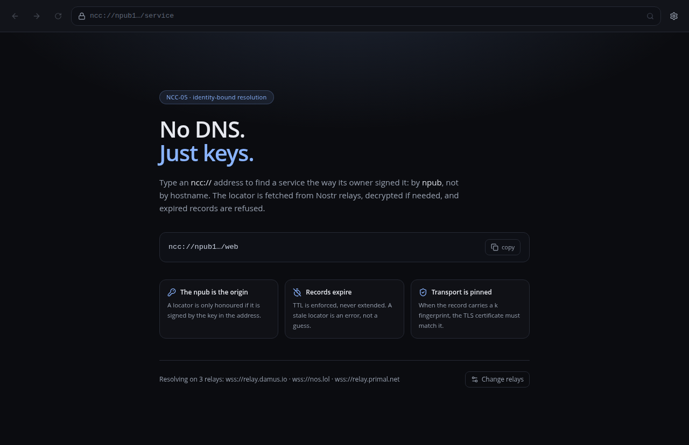
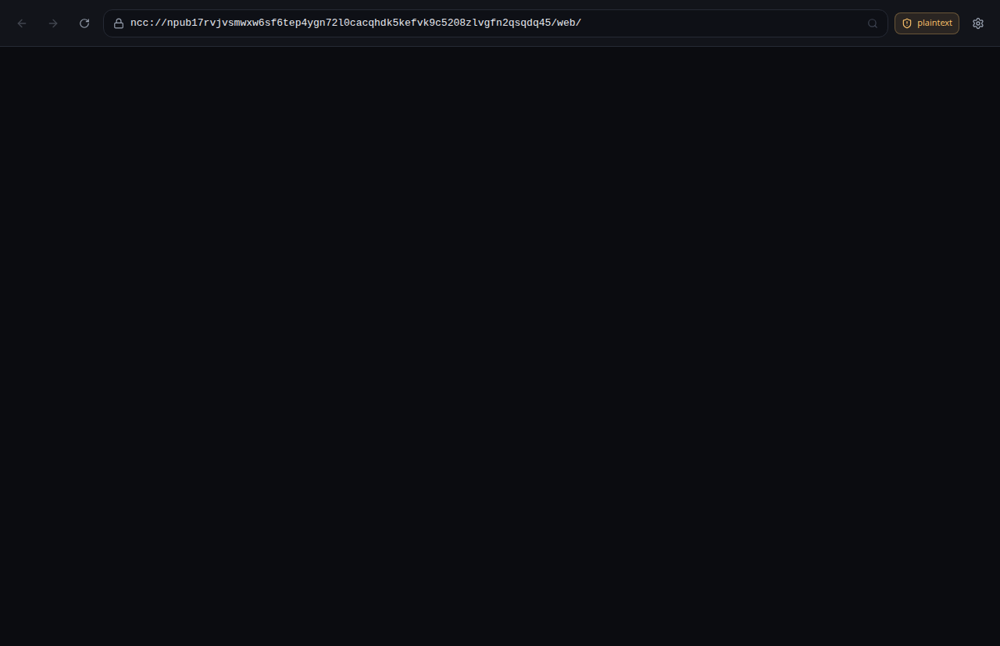
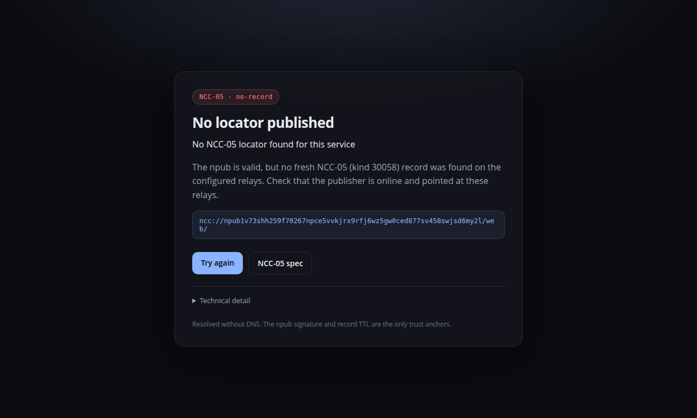

# NCC Browser

A desktop browser that resolves services by **Nostr identity instead of DNS**.

Type `ncc://<npub>/<service>` and the browser fetches an NCC-05 locator (kind `30058`)
from Nostr relays, verifies the signature and TTL, and renders whatever the owner is
currently serving — no domain, registrar, or Dynamic DNS in the path.

Built with Electron 45, React 19, and Vite. The resolver is a spec-correct
implementation on top of `nostr-tools`, not a wrapper around `ncc-05-js` (see
[Why not `ncc-05-js`](#why-not-ncc-05-js)).

**Status:** M0–M2 of [PLAN.md](./PLAN.md) are implemented: resolution, proxy protocol,
pinning, browser chrome, error pages, and relay settings.



| Resolved page | Failure page |
| --- | --- |
|  |  |

---

## Quick start

```bash
npm install
npm run dev      # Electron + Vite with HMR
```

Open an address:

```
ncc://npub1…/web
ncc://npub1…/web/docs
```

The address bar also accepts `npub1…/web`, `ncc:npub1…/web`, and plain `http(s)://`
URLs. A URL passed on the command line opens on launch:

```bash
npm run build
npx electron . 'ncc://npub1…/web'
```

---

## Address model

```
ncc://<npub>/<service>/<path…>?<query>
```

| Segment | Meaning |
| --- | --- |
| `npub` | Owner's Nostr public key. This is the trust anchor. |
| `service` | Locator namespace (`d` tag). Omitted → `addr`. |
| `path` | Forwarded verbatim to the resolved endpoint. |

Because publishers disagree about the `d` tag, the resolver probes, in order:
`<service>`, `<service>-locator` (the `ncc-sidecar` convention), then `addr`. The first
fresh, valid record wins and the matched tag is reported in the UI.

---

## How resolution works

1. Decode the npub to hex.
2. Query configured relays once for
   `{kinds:[30058], authors:[hex], '#d':[candidates]}`.
3. Verify every event signature and author.
4. Select the newest record per `d` tag (`created_at` desc, then lexicographically
   smallest `id`).
5. Decode the payload: plaintext JSON, or NIP-44 if a signer is configured.
6. Enforce expiry: the earliest of the `expiration` tag and `updated_at + ttl`.
   Expired records are never used.
7. Normalise endpoints (`url` / `uri`, scheme-less values, `tcp`→`http`), sort by
   priority (default `1000`) and family, then try them in order.
8. Cache until `expiry` (capped at 120 s so rotations are noticed), negative-cache
   failures for 15 s, and dedupe concurrent resolutions.

Each failure gets its own page: `invalid-address`, `no-record`, `expired`,
`undecryptable`, `invalid-payload`, `no-endpoint`, `relay-error`, `timeout`, and
`endpoint-unreachable`.

---

## Proxying and transport security

The `ncc://` scheme is registered as a privileged, standard, secure scheme. The content
session handles **every** request under the origin, not just top-level documents, so:

- relative and absolute-path subresources work without CORS;
- the page never learns the real `ip:port`;
- one `npub` is one origin, so cookies and storage isolate owners naturally;
- redirects are rewritten back into `ncc://…` (redirects to other hosts are treated as
  "leave NCC" and passed through).

When a locator endpoint is `https` and carries `k`, the SPKI fingerprint is pinned for
that hostname via `setCertificateVerifyProc`, DANE-style:

- match → accept, including self-signed certificates and IP-literal hostnames;
- mismatch → hard refusal (`k-mismatch`), never a fallback;
- no `k` → Chromium's normal CA verification applies.

Chromium reports every refused certificate as a generic `net::ERR_FAILED`, so the verify
proc records *why* it refused and the protocol handler consumes that record to show
`k-mismatch` or `certificate-expired` instead of a vague "unreachable".

The toolbar always shows which mode is in effect: `pinned`, `tls`, or `plaintext`
(amber — the locator is signed, the content is not authenticated). `TESTKEY:`-style
placeholder fingerprints are treated as "no pin", not as a match.

Locator content is decrypted only when an encrypted record is addressed to you. There is
no keychain and no signing in v0.1; for deliberate testing:

```bash
NCC_LOCATOR_NSEC=nsec1… npm run dev
```

---

## Architecture

```
src/main
  index.ts        app lifecycle, launch address, optional signer from env
  shell.ts        BrowserWindow (chrome) + WebContentsView (content)
  protocol.ts     ses.protocol.handle('ncc') — resolve, fetch, rewrite, error pages
  pins.ts         SPKI pin store + setCertificateVerifyProc
  config.ts       relay list persisted to userData/config.json
  ipc.ts          navigate / history / relays / state
  error-page.ts   self-contained failure screens
  ncc/locator.ts  pure: candidates, payload validation, endpoint normalisation
  ncc/resolver.ts relay query, selection, decrypt, cache, dedupe
  ncc/routing.ts  pure: path joining and Location rewriting
src/preload       contextBridge → window.ncc (chrome only)
src/renderer      React toolbar, address bar, security badge, relay settings, welcome
src/shared        ncc:// parser, types, relay validation (no Node imports)
```

Remote content runs with `sandbox: true`, `contextIsolation: true`, no Node, and its own
`persist:ncc-content` partition. It has no preload and no IPC surface.

---

## Testing

```bash
npm test       # 70 unit tests: URL parser, locator rules, resolver, routing, pins, relays
npm run e2e    # real Electron window against a mock relay and a local HTTP service
```

The end-to-end test starts a WebSocket relay, signs real `30058` events, serves an HTTP
page with an external stylesheet and two self-signed HTTPS services, then drives the
running app over the Chrome DevTools Protocol. It asserts rendering, subresource
proxying, relative-link resolution, the synthetic origin, the address bar, plaintext vs
`pinned` transport state, refusal of a certificate that does not match `k`, and the
`no-record` error page. Screenshots land in `/tmp/opencode/ncc-browser-e2e/`.

To try it against a real publisher, run [`ncc-sidecar`](../nostr-community-conventions/ncc-06/ncc-sidecar/)
or [`ncc_publish.py`](../nostr-community-conventions/ncc_publish.py), point both sides at
the same relay, and open `ncc://<their npub>/<service>`.

---

## Why not `ncc-05-js`

The reference resolver has three behaviours that are fatal for a browser addressing
individual services (all verified in source):

1. it queries `30058` without a `#d` filter and keeps only the author's single freshest
   event, so on a multi-service identity the older services become unresolvable;
2. it decrypts only that one newest candidate, so an undecryptable record ends
   resolution instead of falling through to the next candidate;
3. with `strict: false` it returns expired payloads, making "expired" indistinguishable
   from success.

`src/main/ncc/resolver.ts` implements the NCC-05 algorithm directly and keeps the
selection and freshness rules unit-tested. The remaining upstream issues are listed in
[PLAN.md §8](./PLAN.md#8-upstream-fixes-worth-filing-on-nostr-community-conventions).

---

## Relationship to MKStack

MKStack is a web-app framework: it cannot register a custom scheme, bypass CORS to a raw
`ip:port`, pin a TLS SPKI, or control navigation, so it cannot be the browser itself.

The renderer deliberately uses the same stack MKStack generates (React 19 + Vite +
TypeScript + Tailwind + small shadcn-style components), and the planned M4 publisher is a
separate MKStack app (`stacks mkstack`) that publishes locators via NIP-07 — keeping key
material out of this browser entirely. See [soapbox.pub/mkstack](https://soapbox.pub/mkstack).

---

## Known limitations (v0.1)

- **One content view.** Multiple tabs on the same `npub` need a per-view origin; today
  the active-service map is per pubkey.
- **Absolute-path subresources** (`/style.css`) are attributed to the active service for
  that npub. Relative links are unambiguous.
- **Cookies** are stored per `ncc://<npub>` origin. `Set-Cookie` headers carrying a
  `Domain=` attribute from the endpoint will be dropped by Chromium.
- **Pins are keyed by hostname, not host:port** — Chromium's verify proc does not expose
  the port. Two HTTPS services on the same IP with different certificates can collide;
  give each its own address for now.
- **No Tor.** `.onion` and `ws`/`wss`-only endpoints are recognised but not fetchable as
  pages.
- **No NIP-65 gossip** yet; only the configured relay list is queried.
- **Encrypted locators** require `NCC_LOCATOR_NSEC`; there is no signer UI.
- **Clearnet pages** load directly, with normal Chromium error handling.

---

## License

MIT
