# Nostr Navigator

A desktop browser that resolves services by **Nostr identity instead of DNS**.

Type `ncc://<npub>/<service>` and the browser fetches an NCC-05 locator (kind `30058`)
from Nostr relays, verifies the signature and TTL, and renders whatever the owner is
currently serving — no domain, registrar, or Dynamic DNS in the path.

Built with Electron 45, React 19, and Vite. The resolver is a spec-correct
implementation on top of `nostr-tools`, not a wrapper around `ncc-05-js` (see
[Why not `ncc-05-js`](#why-not-ncc-05-js)).

**Status:** M0–M16 are implemented. That includes the resolver, proxy and pinning, the
browser chrome and signer, NCC-02 anchoring with a trust panel, the separate publisher
app in [`publisher/`](./publisher/) (a NIP-07 flow for NCC-05 locators and NCC-02 service
records), bundled Tor with the onion preference/toggle and full Tor tabs, private tabs,
HTTPS policy and HTTP warnings, an address bar with local suggestions, scheme inference
and search engines, identity-resolved relay entries with enforced `k` pins, appearance
themes with text/density/accent controls, an encrypted NIP-78 password manager with
fill/save and TOTP, a Manifest V3 extension host with `chrome.*` compatibility and NCC
Nostr APIs, and packaged Linux, macOS and Windows releases.


| Tabs | Failure page | Settings page |
| --- | --- | --- |
|  |  | 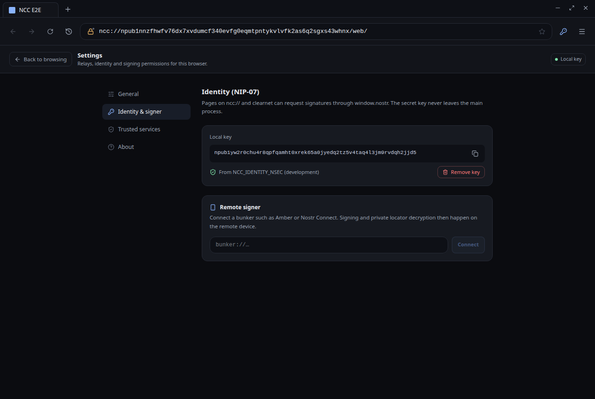 |

| Downloads | Tab history | Site information |
| --- | --- | --- |
| 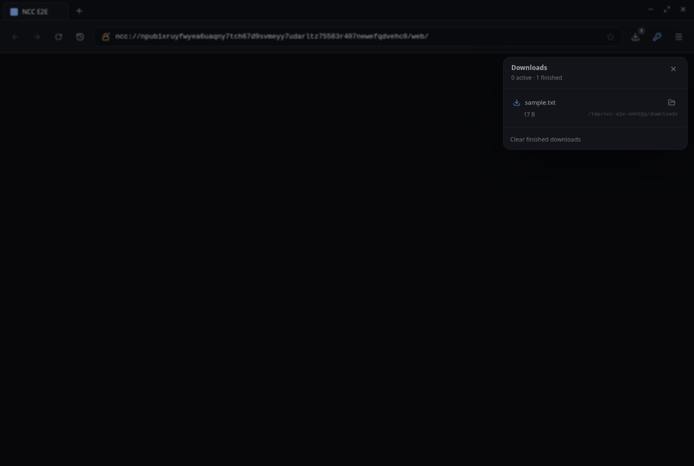 | 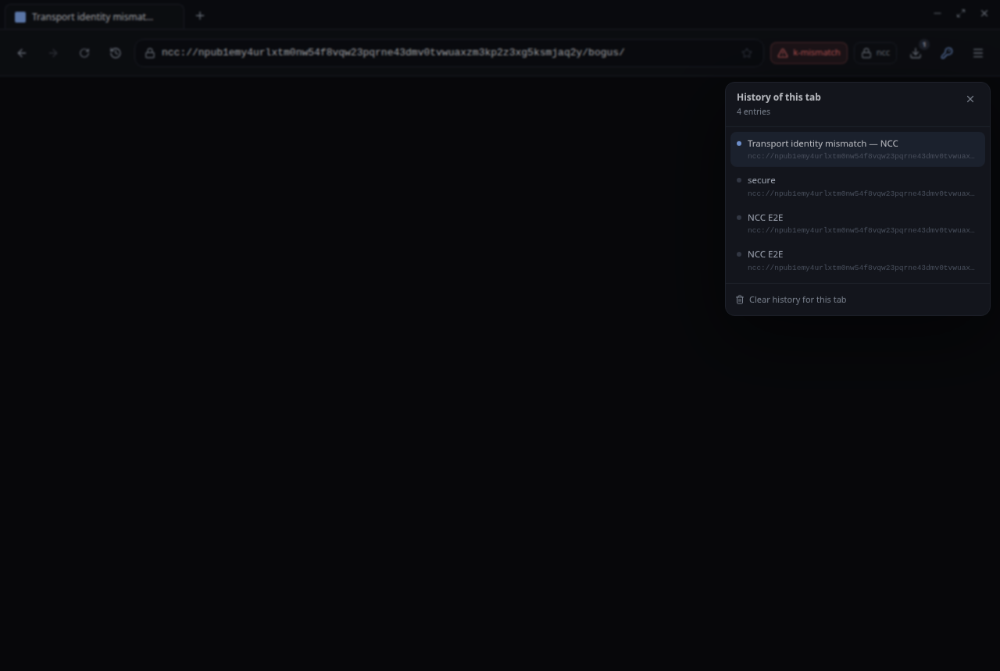 | 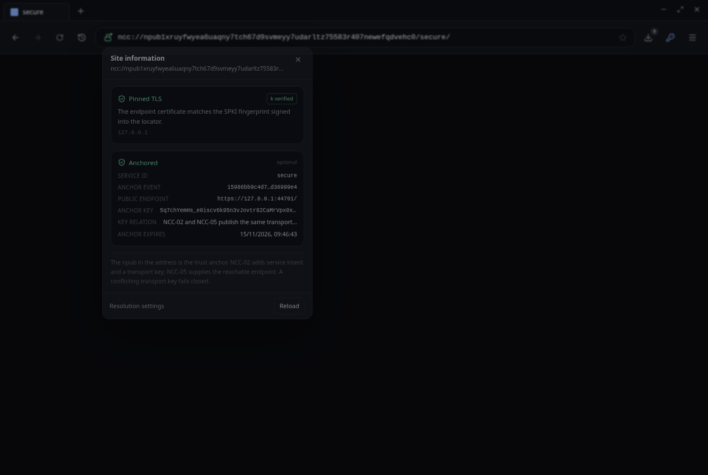 |

| Browser menu | Settings: relays & anchoring | Publisher |
| --- | --- | --- |
| 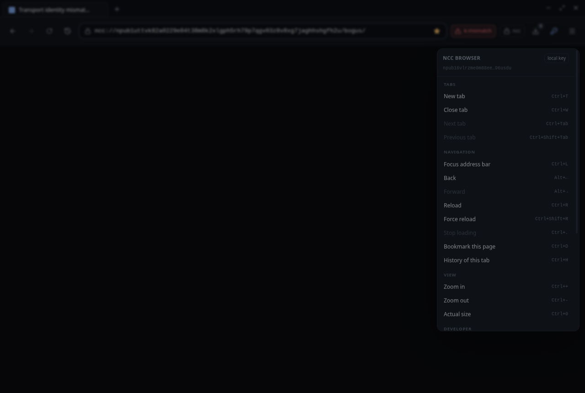 | 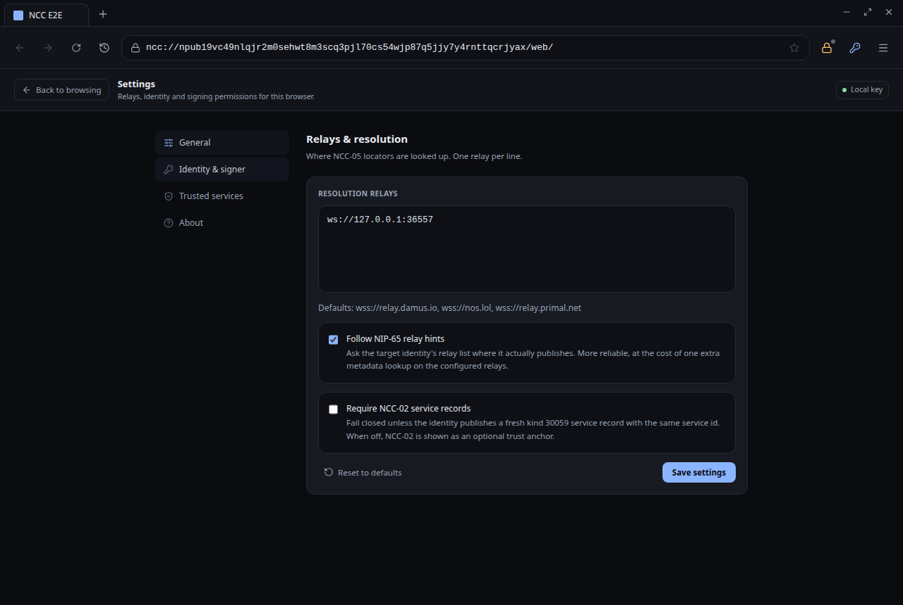 |  |

| Appearance: dark | Appearance: light |
| --- | --- |
| 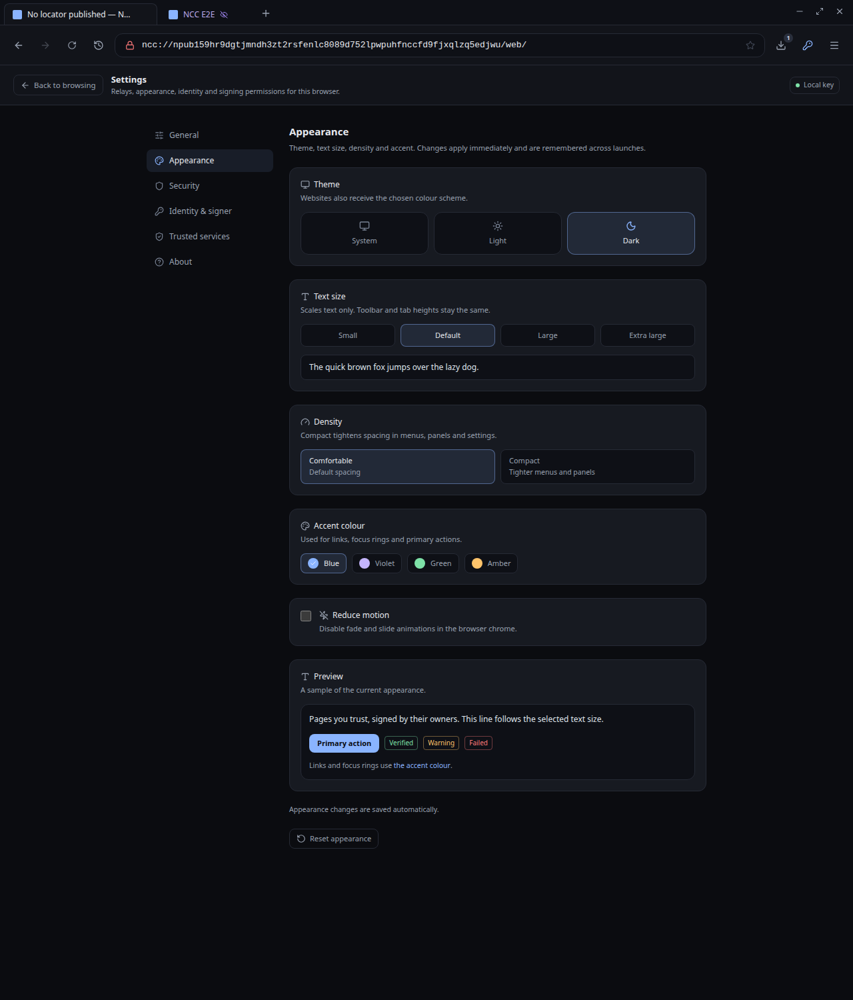 | 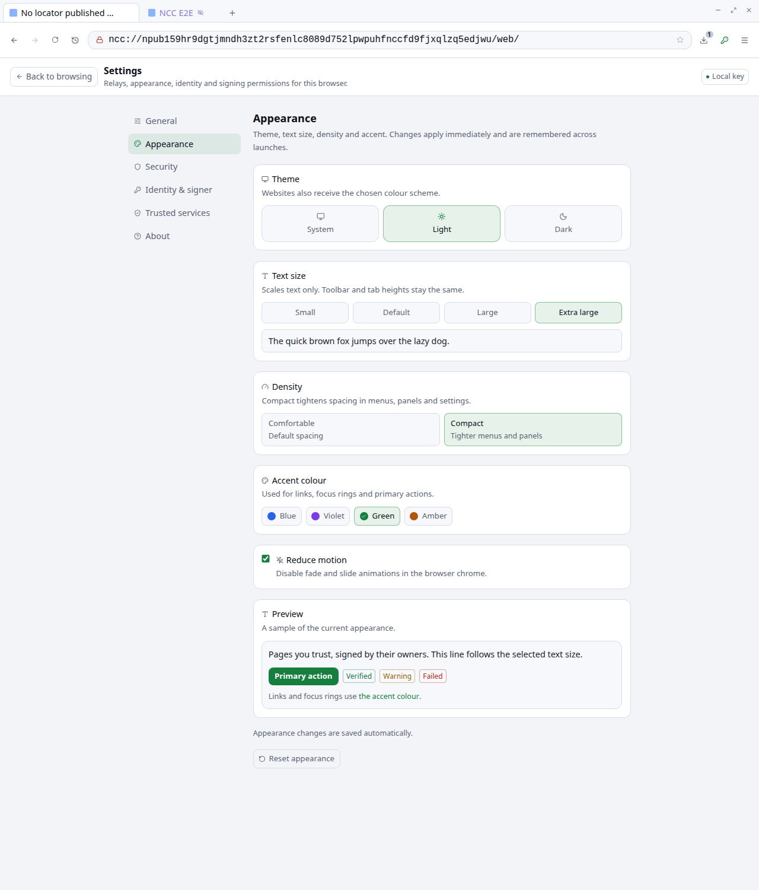 |

| Password manager | Toolbar popover | Save prompt |
| --- | --- | --- |
| 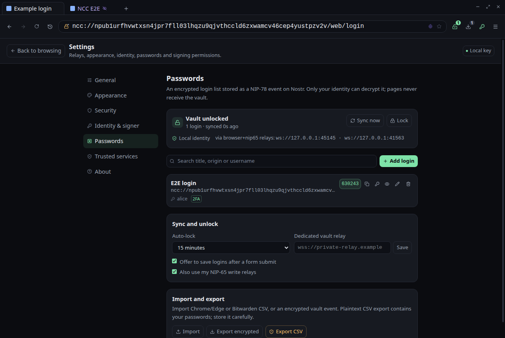 | 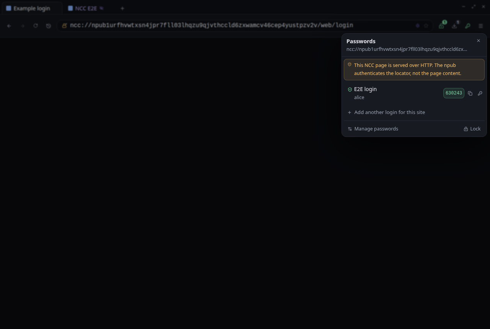 | 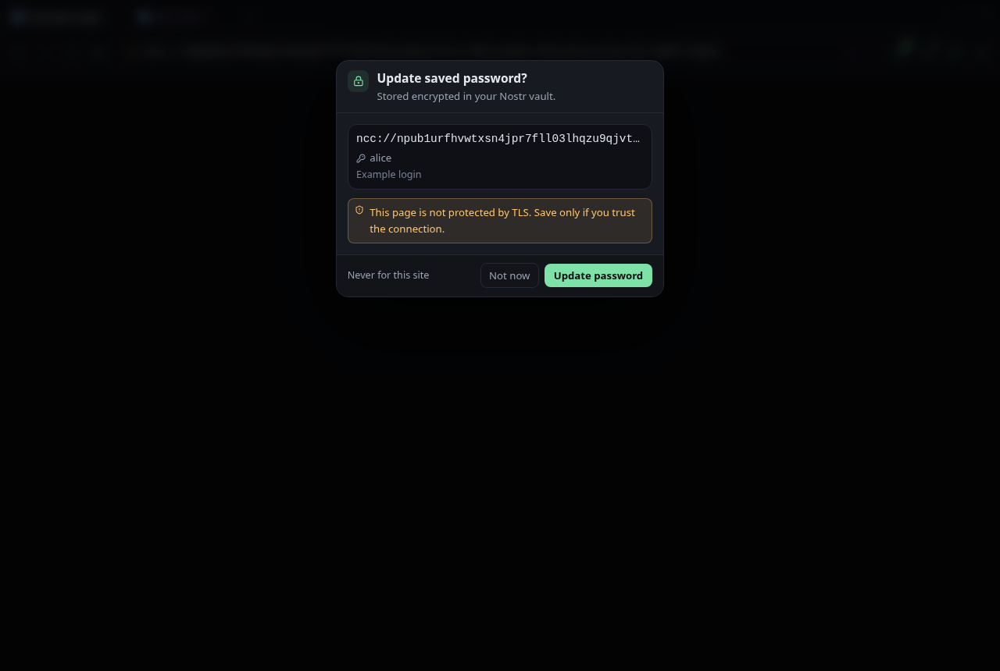 |

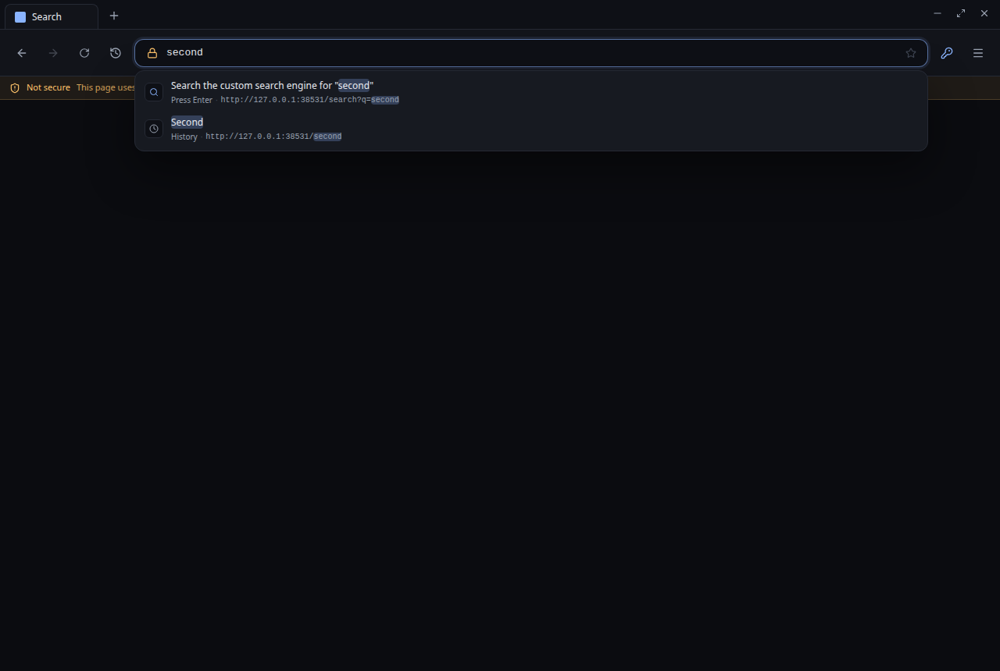

---

## Quick start

```bash
npm install
npm run dev      # Electron + Vite with HMR
```

Open an address:

```
ncc://npub1…/web
ncc://npub1…/web/docs
```

The address bar also accepts `npub1…/web`, `ncc:npub1…/web`, and plain `http(s)://`
URLs, plus `nsite://` for NIP-5A static sites (below). A URL passed on the command line
opens on launch:

```bash
npm run build
npx electron . 'ncc://npub1…/web'
```

---

## Static sites: `nsite://`

NIP-5A sites are served natively, without an HTTP host:

- `nsite://<npub>/` is the author's root site (kind `15128`).
- `nsite://<npub>/<d>/` is a named site (kind `35128`), e.g. `nsite://npub1…/blog/`.

Files are fetched from Blossom and checked against the sha256 in the signed manifest
before a single byte reaches the page, so a mirror can cause a miss but never wrong
bytes. The padlock shows "Nostr site" and the panel lists the manifest's title, aggregate
hash, servers and update time.

Limits worth knowing:

- Addresses are shown as `nsite://<npub>/<d>/` but loaded as `nsite://<npub>.<d>/`, so
  every named site is its own origin and its assets cannot be attributed to another
  site. A d-like first segment (`/armada/`) is treated as a named site only when one is
  published; otherwise it stays a root-site path. If both exist, the named site wins.
- 25 MB per file, no `Range` support yet: video plays only after the whole blob is
  downloaded and verified.
- Manifests are cached for 60 s and refreshed in the background; a forced reload asks
  the relays again. Snapshots (`nsite://v…`) are not supported yet.

A gateway deployment still works and is a useful fallback: publish an NCC-05 locator
whose endpoint is `<npub>.nsite-host.com`, then `ncc://<npub>/site/` resolves through
NCC with TLS pinning as usual.

---

## Publishing a service

[`publisher/`](./publisher/) is a separate single-page app that publishes a locator for a
service running on a local port. It asks a **NIP-07** provider to sign; it never handles
an `nsec`.

```bash
npm install               # root dependencies also cover the publisher
npm run publisher:dev     # http://localhost:5173
```

You can also `cd publisher && npm install && npm run dev`.

Open that URL in Nostr Navigator to use the built-in signer (the approval sheet appears as
usual), or open it in a normal browser with a NIP-07 extension. Fill in the service id,
host/port, relays, and publish. The result is:

```
ncc://<your npub>/<service>
```

The publisher emits a `kind 30058` locator (plaintext or NIP-44-encrypted to your own
key) and, by default, a `kind 30059` NCC-02 anchor with the primary endpoint and optional
TLS `k`. Use `127.0.0.1` when the publisher and browser are on one machine; use a LAN
address and open the firewall for another device.

Build the static app with `npm run publisher:build` (`publisher/dist`). See
[`publisher/README.md`](./publisher/README.md) for the operational details.

---

## Browser chrome

The window is frameless: the tab strip doubles as the title bar, with a drag region and
in-app minimize/maximize/close controls. No native menu bar; every command lives in the
toolbar's hamburger menu, and shortcuts are routed by the main process so they keep
working while the remote page has focus.

- **Tabs** — new/close/switch, middle-click close, drag to reorder, per-tab favicon,
  title and loading spinner. Playing audio shows a speaker icon (click to mute), and an
  overflow button appears when the strip cannot fit every tab, with a searchable list.
  Right-click a tab for reload, duplicate, mute, copy address, close, close others and
  close to the right. A blank tab shows the welcome screen.
- **Private tabs** — a separate in-memory session, a mask indicator and `Ctrl+Shift+N`.
  Cookies, cache, history and remembered signer permissions are dropped when the last
  private tab closes. Private tabs are never written to the restore session.
- **Tor tabs** — a full Tor tab (`Ctrl+Shift+O`) routes page traffic, downloads and NCC
  relay lookups through Tor, disables WebRTC leaking, and is always ephemeral. It is
  separate from the per-locator onion preference.
- **Toolbar** — back/forward (right-click or hold for a jump list), reload/stop
  (the refresh button bypasses the HTTP cache), history, an address bar with local
  suggestions, search, scheme inference, a colour-coded padlock and bookmark star,
  downloads with progress, identity key, hamburger menu.
- **Tor** — release builds bundle Tor; Settings → General has **Prefer Tor connections**
  and an automatic/local SOCKS proxy choice. With the preference off, a locator that
  publishes an onion endpoint gets an onion button in the address bar; clicking it
  reloads that service over Tor, clicking again returns to direct. Direct `.onion` URLs
  work too.
- **Settings** is a page, not a modal: `General`, `Appearance`, `Security`,
  `Identity & signer`, `Passwords`, `Extensions`, `Trusted services` and `About`, with a
  back-to-browsing button. `Esc` also leaves it.
  **General** also picks the search engine and the Tor onion search preference.
  **Appearance** covers light/dark, text size, density, accent colour and reduced motion.
  **Passwords** unlocks the encrypted login vault, lists and edits entries, generates
  passwords, shows TOTP codes, controls sync relays and imports/exports credentials.
  **Extensions** installs packages or unpacked folders, enables/disables them, grants
  private-tab access and shows permissions, warnings and errors.
  **Security** controls Off / Prefer HTTPS / HTTPS only, the optional HTTP interstitial,
  the list of persisted HTTP exceptions, and clearing browsing history.
- **Shortcuts** (also shown in the menu): `Ctrl+T`, `Ctrl+W`, `Ctrl+Tab` /
  `Ctrl+Shift+Tab`, `Ctrl+Shift+N` (private tab), `Ctrl+Shift+O` (Tor tab), `Ctrl+L`,
  `Ctrl+R`, `Ctrl+Shift+R`, `Ctrl+.`, `Ctrl+D` (bookmark), `Ctrl+H` (history),
  `Ctrl+J` (downloads), `Alt+←/→`, `Ctrl++/-/0`, `Ctrl+Shift+I/J`, `Ctrl+Q`. On macOS
  `Cmd` replaces `Ctrl`. `Ctrl+R` is a normal reload; the toolbar
  refresh uses the `Ctrl+Shift+R` path (clear the content session cache, then reload).
- **Right-click content** — links (open in new tab, copy address), images (open, copy
  address, save), editable fields (cut/copy/paste/select all), plus back/forward/reload
  and inspect element.
- **Downloads** — a session list that survives chrome reloads, with byte progress,
  cancel, reveal in folder, and clear-finished. Files are saved under `~/Downloads`
  unless `NCC_DOWNLOAD_DIR` is set.
- **History** — the toolbar and `Ctrl+H` list every entry in the active tab; selecting
  one jumps straight to it. History is per tab and can be cleared from the panel.
- **Bookmarks** — the star in the address bar toggles the current page; the hamburger
  menu lists bookmarks with remove buttons. They are local to this browser.
- **Session restore** — normal tabs, the active tab and window geometry are saved to
  `userData/session.json` and restored on the next launch. Private and Tor tabs are never
  restored; only addresses are stored.
- **Window title** follows the active page.

---

## Appearance

Settings → **Appearance** changes the browser chrome immediately; there is no Save
button, and the choice is stored in `config.json`.

| Setting | Options | Notes |
| --- | --- | --- |
| Theme | System, Light, Dark | Dark is the default. The chosen scheme is also passed to pages through `prefers-color-scheme`, so sites with their own dark mode follow it. |
| Text size | Small, Default, Large, Extra large | Scales text only. Padding, gaps and the 38 px tab strip / 60 px toolbar stay fixed. |
| Density | Comfortable, Compact | Compact tightens spacing in menus, panels and settings without moving the shared chrome heights. |
| Accent colour | Blue, Violet, Green, Amber | Drives links, focus rings and primary buttons. Each preset has a light and a dark variant for contrast. |
| Reduce motion | On/off | Collapses transitions and animations. `prefers-reduced-motion` is honoured even when this is off. |

The theme is driven by Electron's `nativeTheme`: setting Light or Dark also overrides
`prefers-color-scheme` for page content, while System follows the operating system.
Error and HTTP-warning pages, the window background, native form controls and
scrollbars follow the same choice. **Reset appearance** returns every field to its
default. Native context menus are drawn by the OS and still follow the system theme.

---

## Password manager

The password manager is a **NIP-78 encrypted list** stored on Nostr. One addressable
kind `30078` event with `d = ncc-browser/passwords/v1` holds the whole vault; the event
content is NIP-44 self-encrypted with the active identity. The relay sees only ciphertext,
the author, timestamps and the approximate size.

- **Unlock** uses the active Nostr identity and a session auto-lock (15 minutes by
  default). Locked vaults reveal nothing, not even entry titles.
- **Origins** are exact `https://host[:port]` or `ncc://<pubkey>/<service>` values. Plain
  HTTP is refused; `ncc://` over HTTP is allowed with a warning because the npub is the
  anchor.
- **Toolbar popover** lists logins matching the active origin. Clicking one fills the
  visible login form in the isolated content preload; the password never passes through
  the chrome renderer. Fill is never automatic and never submits the form.
- **Save prompt** appears after a real form submit. It shows the exact origin and
  username, never the password, and offers Save/Update, Never for this site, or Not now.
  Private tabs and Tor tabs never offer to save.
- **TOTP** secrets stay inside the encrypted vault. Codes are generated in the main
  process and can be displayed or copied from the toolbar and Settings.
- **Storage** uses the browser relays plus the identity's NIP-65 write relays, with an
  optional dedicated vault relay that overrides both. Saves are retried when a relay is
  offline; the local cache contains only the signed ciphertext event.
- **Import/export** supports Chrome/Edge and Bitwarden CSV, plus the encrypted vault
  event. CSV export is plaintext and requires an explicit confirmation.

The Nostr key is the recovery key: losing it loses the vault. The vault is not encrypted
with a separate master passphrase in this version.

---

## Extensions

Chromium's content-script engine cannot inject into `ncc://` pages, so the browser ships
its own extension host. It keeps the Manifest V3 authoring model and a documented subset
of `chrome.*`, and adds NCC-native APIs:

- **Content scripts** run on both `https://` and `ncc://` pages in a per-extension
  isolated world. A page cannot see `chrome`, `ncc`, or the IPC bridge.
- **Manifest patterns** add `ncc://*/*`, `ncc://<npub>/*` and
  `ncc://<npub>/<service>/*`.
- **Background** runs as a suspendable hidden sandboxed page with `chrome.runtime`,
  `chrome.storage`, `chrome.tabs`, `chrome.scripting`, `chrome.action`,
  `chrome.contextMenus`, `chrome.notifications` and `chrome.i18n`.
- **Toolbar actions and popups**, an options page, and a Settings → Extensions manager.
- **`ncc.nostr`** exposes `getPublicKey`, `signEvent`, `getRelays`, NIP-04 and NIP-44 to
  extensions, gated by manifest permissions and the normal approval sheet.
- **Packages** install from a `.zip`/`.nccx` file or, in developer mode, an unpacked
  folder. Packages are copied into `userData/extensions/<id>` before loading.
- **Private tabs** run extensions only with a per-extension grant; **Tor tabs** never run
  them and never expose their URLs. `ncc.storage.private` is ephemeral.
- **Porting** is supported by `packages/extension-sdk`: `ncc-ext port` rewrites the
  manifest, optionally adds NCC match patterns and reports unsupported APIs.

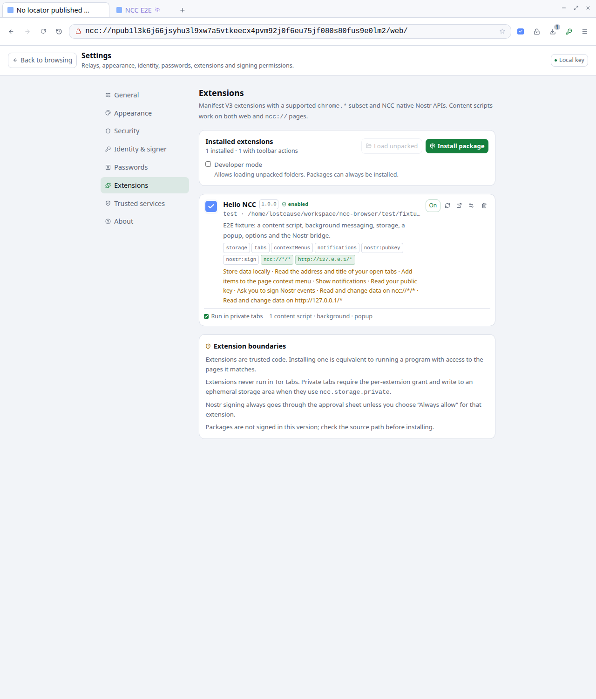

See [`docs/extensions.md`](./docs/extensions.md) for the manifest, API table, security
model and limitations.

---

## Address bar and search

The address bar classifies input locally before anything is sent anywhere, and the
dropdown always states what Enter will do:

| Input | Result |
| --- | --- |
| `ncc://npub1…/web`, `npub1…`, `npub1…/web`, 64-hex | `ncc://…` (default service `addr`) |
| `https://…`, `http://…` | as typed, subject to the HTTPS policy |
| `example.com`, `sub.example.com:8443` | `https://…` |
| `localhost:5173`, `127.0.0.1`, `[::1]`, `*.local` | `http://…` |
| `abc.onion/path` | `http://abc.onion/path` over Tor |
| words, phrases, a single label, leading `?` | search |
| any other `scheme:` | local error |
| `nsec1…` / `ncryptsec1…` | refused locally; never searched, stored or logged |

- **Suggestions are local** — bookmarks, normal-tab history, tabs of the same kind and
  NCC services already seen for a typed npub. Focusing an empty address bar shows recent
  sites and bookmarks. Nothing is fetched from the search engine as you type.
- **Keyboard** — `↑`/`↓` select, `Enter` opens the highlighted row, `Tab` completes the
  URL, `Esc` closes the dropdown (a second `Esc` restores the draft), `Alt+Enter` opens
  the row in a new tab of the same kind.
- **Search engines** — DuckDuckGo (default), Brave, Startpage, Google, Bing, SearXNG and
  a custom `%s` template. HTTPS is required except for loopback and `.onion` hosts; a
  misconfigured engine falls back to DuckDuckGo and Settings shows the error.
- **Tor** — full Tor tabs use DuckDuckGo's onion endpoint when **Use onion search in Tor
  tabs** is on, otherwise the engine's normal URL over the tab's fixed proxy.
- **History** lives in `userData/history.json`: normal tabs only, deduplicated with visit
  counts, capped at 3000 entries and 180 days. Private and Tor tabs are never recorded,
  and Settings → Security clears it.

---

## Address model

```
ncc://<npub>/<service>/<path…>?<query>
```

| Segment | Meaning |
| --- | --- |
| `npub` | Owner's Nostr public key. This is the trust anchor. |
| `service` | Locator namespace (`d` tag). Omitted → `addr`. |
| `path` | Forwarded verbatim to the resolved endpoint. |

Because publishers disagree about the `d` tag, the resolver probes, in order:
`<service>`, `<service>-locator` (the `ncc-sidecar` convention), then `addr`. The first
fresh, valid record wins and the matched tag is reported in the UI.

---

## How resolution works

1. Decode the npub to hex.
2. Query configured relays once for
   `{kinds:[30058], authors:[hex], '#d':[candidates]}`.
3. When gossip is on, also fetch the identity's NIP-65 relay list (kind `10002`) and
   add its read/both relays to the same query (capped at 8, read-only entries).
4. Verify every event signature and author.
5. Select the newest record per `d` tag (`created_at` desc, then lexicographically
   smallest `id`).
6. Decode the payload: plaintext JSON, or NIP-44 if a signer is configured.
7. Enforce expiry: the earliest of the `expiration` tag and `updated_at + ttl`.
   Expired records are never used.
8. Normalise endpoints (`url` / `uri`, scheme-less values, `tcp`→`http`), sort by
   priority (default `1000`) and family, then try them in order.
9. Cache in memory for up to 120 s, and write public records to
   `userData/locator-cache.json` for restart-safe resolution. A persisted record is
   reused without a relay query for 60 s; after that it is served immediately while a
   background query confirms it. Encrypted records are never persisted. Failures are
   negative-cached for 15 s, and failed endpoints cool down with exponential backoff
   (15 s → 5 min).

### Locator freshness

A record is a hint, not a permanent address. Publishers rotate endpoints, and the
browser has to notice without a restart.

- **In memory:** repeated requests reuse a resolution for up to 120 s.
- **On disk:** `locator-cache.json` survives restarts but is trusted for only 60 s
  (`NCC_REVALIDATE_SECONDS` overrides this for tests). An older entry is served
  immediately *and* refreshed in the background; when relays return a newer record it
  replaces the cached one, so the next request uses the new endpoint.
- **Dead endpoint:** when every endpoint in a record refuses a connection, the document
  request drops that record and re-resolves once. A rotation costs one failed attempt,
  not the rest of the record's TTL.
- **NCC-02 fallback:** a record synthesised from an anchor `u` endpoint lives at most
  5 minutes, so a real NCC-05 locator takes over soon after it is published.
- **Anchored mode:** a cached record is not accepted when its anchor's `exp` has
  passed; relays are asked again.
- **Manual escape hatches:** padlock → **Locator record** shows the `d` tag, age,
  expiry and source, with **Re-resolve**. `Ctrl+Shift+R` and Settings → Security →
  **Clear cache** also drop resolved locators.

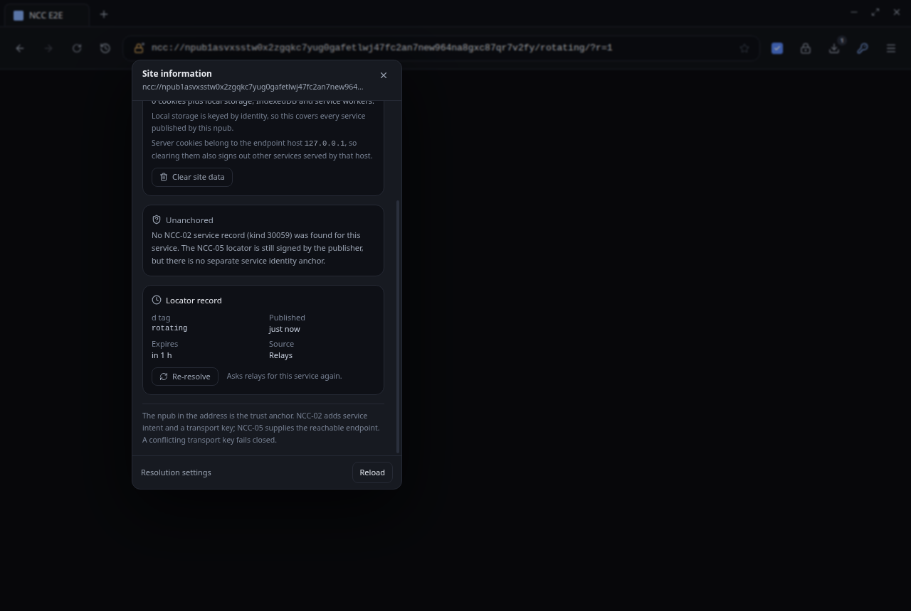

## Relays by identity

A relay does not have to be a fixed `wss://` address. Settings → General → Relay rows
accept `ncc://<npub>/<service>` (a bare `ncc://<npub>` means the `relay` service), and a
bunker URL may list `relay=ncc://…` parameters. Resolution uses the same NCC-05 path as
a page, in a relay mode that accepts `ws`/`wss` endpoints and never leaks them into page
navigation.

- The **latest fresh record** wins; expiry is the earliest of the `expiration` tag and
  `updated_at + ttl`.
- **Onion endpoints** are used only when Tor is ready. Without it they are skipped, and
  an onion-only locator reports `onion-requires-tor` instead of silently failing.
- **Cleartext `ws://`** is accepted only for loopback and onion hosts. Anywhere else the
  endpoint is rejected, because a relay carries signed DMs and NIP-46 traffic.
- **The locator's `k` is enforced.** Relay sockets are opened by the main process, not
  Chromium, so a dedicated TLS check compares `base64url(sha256(SPKI))` against `k`:
  a self-signed certificate is accepted only when the fingerprint matches, an expired
  certificate is rejected, and a locator without `k` requires a normal CA-valid chain.
  Pins are keyed by `host:port`.
- **Rotation is automatic.** Each entry is re-resolved shortly before its record
  expires, with 30–180 s of jitter, and the endpoint, pin and live connection move
  together. A failed refresh keeps the previous address and marks the row stale rather
  than breaking resolution.
- **Bootstrap:** locator lookups query the configured plain relays plus each
  identity-resolved relay's last known address, falling back to the built-in defaults
  only when the list is empty. This avoids the circular case where every relay is an
  identity.
- **NIP-46** reads its relay list on every request, so a rotated bunker relay needs no
  reconnect. The resolved list is persisted with the session and re-resolved while the
  browser runs.

Each failure gets its own page: `invalid-address`, `no-record`, `expired`,
`undecryptable`, `invalid-payload`, `no-endpoint`, `relay-error`, `timeout`, and
`endpoint-unreachable`.

---

## Proxying and transport security

The `ncc://` scheme is registered as a privileged, standard, secure scheme. The content
session handles **every** request under the origin, not just top-level documents, so:

- relative and absolute-path subresources work without CORS;
- the page never learns the real `ip:port`;
- one **service** is one origin (`ncc://<npub>.<service>`), so cookies, local storage and
  service workers isolate services as well as owners. The address bar still shows
  `ncc://<npub>/<service>`, which is input only and redirects to the origin form;
- redirects are rewritten back into `ncc://…` (redirects to other hosts are treated as
  "leave NCC" and passed through);
- pages get a genuine secure context: `crypto.subtle`, CacheStorage, service workers and
  same-origin `fetch()` all work, which PWAs need during boot.

There is no `nccs://` scheme: transport is a property of the resolved record, not of the
address, so it can rotate without changing the origin (see `PLAN.md` §3). All custom
schemes are registered in a single `registerSchemesAsPrivileged()` call — a second call
silently drops `secure`/`supportFetchAPI` from the schemes registered by the first.

When a locator endpoint is `https` and carries `k`, the SPKI fingerprint is pinned for
that hostname via `setCertificateVerifyProc`, DANE-style:

- match → accept, including self-signed certificates and IP-literal hostnames;
- mismatch → hard refusal (`k-mismatch`), never a fallback;
- no `k` → Chromium's normal CA verification applies.

Chromium reports every refused certificate as a generic `net::ERR_FAILED`, so the verify
proc records *why* it refused and the protocol handler consumes that record to show
`k-mismatch` or `certificate-expired` instead of a vague "unreachable".

The address bar has one padlock instead of separate transport and trust chips:

- **green** — secure TLS, either pinned (the endpoint certificate matches the signed
  `k`) or CA-validated, with a green dot when NCC-02 anchoring is present;
- **amber** — plaintext HTTP (the locator is signed, the content is not authenticated);
- **red** — the page failed security or resolution (`k-mismatch`, `no-anchor`,
  `no-record`, …).

Clearnet pages use the same padlock: green for HTTPS, amber for plaintext HTTP, and red
when the page fails to load. Clicking the padlock opens **Site information**, where
pinned TLS is marked `k verified`; it also shows transport, host, NCC-02 anchor, `u`/`k`,
expiry and the failure explanation. The small dot is the anchor state (green anchored,
amber expired/invalid, grey unanchored). `TESTKEY:`-style placeholder fingerprints are
treated as “no pin”, not as a match.

Locator content is decrypted only when an encrypted record is addressed to you. The
identity from the settings page is used for that automatically; there is no separate
locator key.

---

## Tor and onion services

Locators may publish `.onion` endpoints. They are normal `http`/`https` URLs whose
hostname ends in `.onion`; the resolver tags them `family: 'onion'` and the transport
layer decides whether to use them.

- **Bundled Tor** — release builds include the official Tor Expert Bundle for their
  platform. The browser starts it lazily on the first onion request, on a private
  loopback SOCKS port, with a data directory under `userData/tor`. If the bundled binary
  is missing or cannot bootstrap, it falls back to a local proxy on `127.0.0.1:9050` or
  `9150` (a Tor daemon or Tor Browser).
- **Settings → General → Tor** — **Prefer Tor connections** uses the onion endpoint
  automatically whenever the locator publishes one; records without an onion endpoint
  still load directly. **Tor proxy** selects automatic (bundled) or a specific local
  SOCKS5 proxy; **Test connection** reports the active proxy and any bootstrap error.
- **Manual toggle** — with the preference off, an onion button appears at the right of
  the address bar whenever the locator has an onion endpoint. Clicking it force-reloads
  that `pubkey:service` over Tor; clicking again returns to its direct endpoints. The
  address stays `ncc://…`.
- **Direct onion URLs** — typing `http://something.onion` works too. A PAC sends only
  `*.onion` hosts to Tor; clearnet traffic stays on the normal path.
- **Fail closed** — if Tor is selected but unavailable, or a locator is onion-only and
  the preference is off, the browser shows `tor-unavailable` / `onion-only` instead of
  silently connecting directly.
- **Strict page isolation** — a page loaded over Tor may load only `ncc://`, inert local
  schemes and `.onion` resources. Clearnet subresources, WebSockets and redirects are
  blocked so the request cannot reveal the user's IP. Pages that depend on clearnet CDNs
  will lose those assets; load them without Tor if that is acceptable.
- **Security display** — HTTP onion pages keep the amber padlock (HTTP is still HTTP),
  but the onion button and **Site information** explain that Tor provides the encrypted
  transport and authenticates the onion address. HTTPS onion endpoints still use `k`
  pinning.

Tor updates are security updates. The version and per-asset SHA-256 pins live in
[`scripts/tor-version.json`](./scripts/tor-version.json); `npm run tor:fetch` stages them
for local packaging, and the release workflow downloads the same pins. The staged bundle
ships Tor's BSD licence and a source notice alongside the binary.

---

## Cookies, cache and site data

- **Padlock → Cookies and site data** clears cookies plus `localStorage`, IndexedDB,
  CacheStorage and service workers for the current site. The first click arms the button
  and the second confirms.
- **Forget trust decisions** is an opt-in checkbox on that card. It also removes the HTTP
  exception, the “Always allow” NIP-07 permission and any never-save password rule for
  the service.
- **NCC scope** — DOM storage is keyed by `ncc://<npub>`, so clearing covers every
  service published by that identity. Server cookies belong to the resolved endpoint
  host because that is where the protocol handler fetches documents, so clearing them
  also signs out other services on the same endpoint. The card names that host.
- **Settings → Security → Cache** lists the normal, private, Tor and extension cache
  sizes plus resolved locators, and clears both the network cache and
  `locator-cache.json`. Cookies, sign-ins and site data are untouched.
- Private and Tor sessions are already wiped when their last tab closes; their cache
  row drops to zero then.
- Site data does **not** touch saved passwords (Settings → Passwords), extension storage
  (Settings → Extensions), bookmarks, history or the on-disk locator cache.
- Chromium has no per-origin HTTP cache API, so per-site clearing covers cookies and
  storage while the network cache is cleared session-wide. **Force reload** also clears
  the cache before reloading.

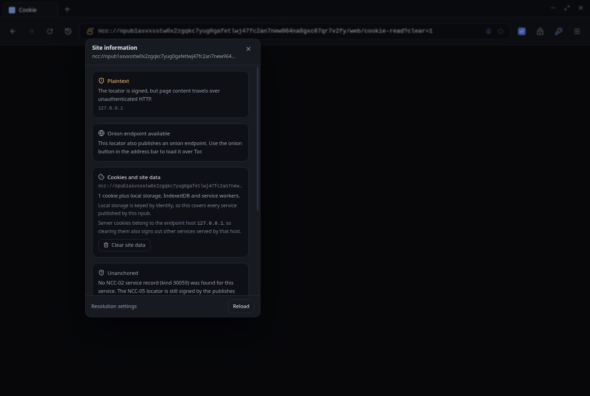

---

## Private tabs

Private tabs use an in-memory content session (`ncc-private`) separate from normal
browsing. All private tabs share it, so a login works across private tabs, but the
session is cleared when the last private tab closes.

- Cookies, cache, auth cache and host resolver cache are cleared with the session.
- The on-disk locator cache is bypassed; resolutions stay in memory.
- NIP-07 “Always allow” decisions are **session-only**. Private tabs neither inherit nor
  write the persistent trust list; the approval sheet says “Remember for this session”.
- Download metadata is marked `private` and removed when the session ends; downloaded
  files remain on disk.
- History is already per-tab and disappears with the tab. Bookmarks can still be created
  deliberately.
- Private tabs are never written to `session.json`; a private-only session restores as a
  blank normal tab.

The tab strip uses a mask indicator, the address bar shows a **Private** badge, and
`Ctrl+Shift+N` opens a new private tab.

---

## Tor tabs

A Tor tab is stronger than the per-locator onion toggle. It uses a separate in-memory
session (`ncc-tor`) with a **fixed SOCKS5 proxy for every request**:

- Clearnet pages, NCC endpoint fetches, subresources and downloads go through Tor.
- NCC-05 relay queries from a Tor tab use a Tor-aware WebSocket pool, so relays do not
  see the user's IP or the npub being resolved.
- WebRTC is set to `disable_non_proxied_udp` for the tab.
- Endpoint selection prefers an onion endpoint, otherwise uses the published clearnet
  endpoint over Tor. The address bar shows a permanent **Tor** badge instead of the
  per-page onion toggle.
- Tor tabs are always ephemeral: no cookies/storage or session restore, no persistent
  locator cache, no persistent NIP-07 permissions.
- If Tor cannot start, the tab fails with `tor-unavailable`; it never falls back to a
  direct connection.
- The approval sheet warns that **NIP-46 remote-signer relay traffic is not routed
  through Tor** yet; NCC relay lookups and page traffic are.

`Ctrl+Shift+O` opens a Tor tab. Tor tabs and the global **Prefer Tor connections** setting
are independent: the setting controls endpoint choice in normal/private tabs, while a Tor
tab always proxies all traffic.

---

## Secure connections and HTTP warnings

Settings → **Security** controls the HTTPS policy:

- **Off** — navigate HTTP normally; the amber warning bar still appears.
- **Prefer HTTPS** — try HTTPS first. If it fails, fall back to HTTP after the optional
  interstitial. This is the default.
- **HTTPS only** — never load HTTP silently. The browser either uses a published HTTPS
  endpoint or shows a blocking `HTTPS is unavailable` interstitial with an explicit
  continue/exception.

Details:
- Loopback hosts (`localhost`, `127.0.0.0/8`, `::1`) and `.onion` services are exempt
  from automatic upgrades. Tor-encrypted onion HTTP is not made TLS.
- NCC endpoints are never rewritten to invented HTTPS ports. The resolver prefers an
  HTTPS endpoint the publisher actually published, then falls back according to the
  policy.
- **Ask before loading HTTP pages** adds a blocking interstitial for clearnet HTTP URLs
  and a self-contained warning page for NCC HTTP endpoints. The page only loads after
  **Continue once** or **Always allow this site**.
- The amber banner always appears on HTTP pages: “Not secure” for clearnet and “HTTP
  over Tor” when Tor provides the path but there is no TLS.
- “Always allow” exceptions persist for normal tabs and live only for the current private
  or Tor session. Settings → Security lists and clears persisted exceptions.
- NCC HTTP exceptions are bound to the `ncc://<npub>/<service>` service, not the raw
  endpoint host, so a locator rotation does not silently disable the warning.

---

## NCC-02 anchoring and trust

NCC-02 service records (`kind 30059`) are the identity and trust anchor for a service;
NCC-05 supplies the reachable endpoint. The browser is in **optional anchoring** mode by
default: it uses a fresh NCC-02 record when one exists and flags the service as
`unanchored` when it does not. Settings → General → **Require NCC-02 service records**
turns that into a hard requirement.

- **Site information** — click the address-bar padlock for the service id, anchor event,
  `u` endpoint, `k`, key relation, expiry and transport. A red padlock means the page
  failed; its panel carries the error code and explanation.
- **Fallback** — when NCC-05 has no usable endpoint, a valid NCC-02 `u` endpoint can
  serve the page (marked as an NCC-02 fallback). This is how a private service with no
  public locator still works.
- **Key binding** — a comparable NCC-02 `k` fills in a missing endpoint fingerprint; if
  NCC-02 and NCC-05 advertise different fingerprints for the same origin, the endpoint
  is refused (`anchor-k-mismatch`). A key is only applied to an `https` endpoint.
- **Required mode failures** — `no-anchor`, `anchor-expired` and `anchor-invalid` have
  their own error pages. Optional mode keeps browsing and shows the anchor status in the
  toolbar.
- **Expiry** — `exp` is enforced; a record without `exp` is accepted for compatibility
  and shown as “no exp tag”.

Attestations (`kind 30060`) and revocations (`kind 30061`) are not evaluated yet.

---

## Nostr identity and NIP-07

The browser has a built-in signer, so pages get a normal `window.nostr` without any
extension. It is available on **top-level `ncc://` pages and clearnet pages**, and it is
not injected into subframes or into the trusted chrome.

Supported methods: `getPublicKey`, `signEvent`, `nip04.encrypt/decrypt`,
`nip44.encrypt/decrypt`, and `getRelays`.

The identity can be either a **local key** or a **NIP-46 remote signer**; pages cannot
tell the difference.

- **Signing never happens in the page.** Pages send a request over IPC; the main process
  signs locally or forwards it to the remote signer, and returns only the result.
- **Local keys at rest** are encrypted with Electron `safeStorage` (OS keychain). If no
  keychain is available, the key stays in memory for the session and the UI says so.
- **Approval is per service.** The first request opens an in-app sheet over the page,
  showing the exact event being signed; "Always allow" is remembered per
  `ncc://<npub>/<service>` for NCC pages, and per origin for clearnet. While the sheet is
  open the remote page is hidden, so it cannot fake or cover the prompt. Settings →
  Trusted services lists remembered origins with a revoke button, and the padlock's site
  panel toggles trust for the page in front of you.
- **Prompts do not pile up.** Identical requests made at the same time share one sheet,
  and each origin has its own queue, so a page waiting on approval does not block other
  sites. Two calls repeat on every load and are granted to the origin for the session
  once approved: reading your public key, and NIP-42 relay logins (kind 22242, shown as
  "log in to a relay"). Publishing, reacting, and encrypting or decrypting content still
  ask every time. A refusal stops the same request being asked again for 30 seconds.
- **Validation** rejects malformed kinds, non-string tags, events more than 15 minutes in
  the future, and content over 1 MB before anything reaches the signer.
- **Development overrides:** `NCC_IDENTITY_NSEC` loads a local key from the environment,
  `NCC_SIGNER_AUTO_APPROVE=1` skips the approval sheet, and `NCC_NIP46_TIMEOUT_MS`
  changes the remote-signer timeout (default 60 s). All three are for development/e2e.

The toolbar has a key icon for the current identity (accent when configured, with a
pending dot when a request is waiting). Clicking it opens the **Identity & signer** page.

Settings → Identity & signer imports an `nsec` (or 64-char hex), generates a new
identity, shows the npub, and removes it.

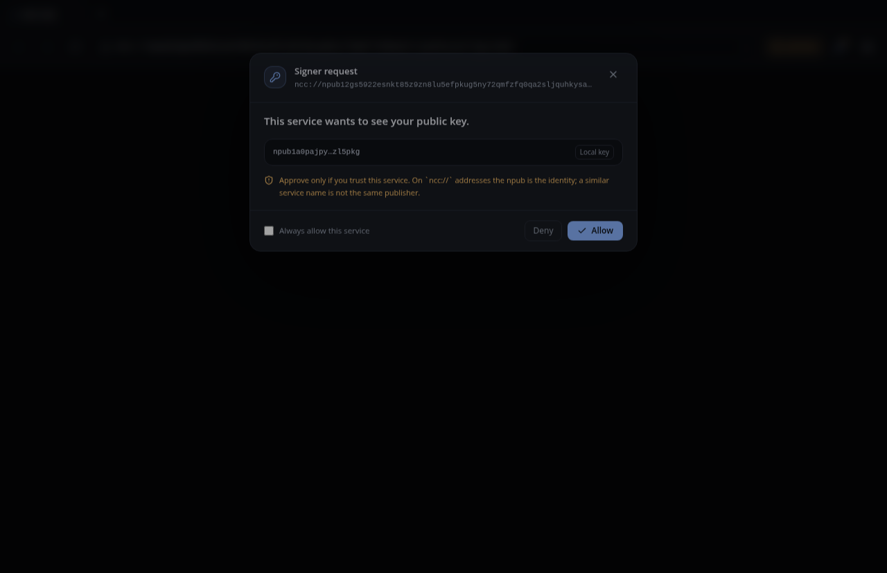

### Remote signing (NIP-46)

Settings → Identity & signer → **Remote signer** accepts a `bunker://` URL (Amber,
Nostr Connect, nsec.app, …). The flow is:

1. The browser generates a **client key** used only to encrypt the NIP-46 channel and
   signs the connect request.
2. The remote signer approves the connection on the user's device; the browser stores
   the session (remote pubkey, relays, secret, encrypted client key) in `userData`.
   A relay given as `ncc://<npub>/<service>` in the bunker URL is resolved first, and
   its endpoint and `k` pin are stored with the session.
3. Every NIP-07 call becomes a `kind 24133` request to the signer. The browser still shows
   its own per-service approval first, so the user sees *which service* is asking; the
   device then confirms the signature.
4. Disconnecting removes the session and falls back to any saved local key.

Targeted NCC-05 locators work too: the browser calls the signer's `nip44_decrypt` with
the publisher's pubkey instead of deriving a conversation key, so the identity key never
has to exist locally. A signer that does not implement `nip44_decrypt` can still browse
public locators.

NIP-46 sessions are encrypted with `safeStorage` like local keys. Without an OS keychain
the session is ephemeral and must be reconnected after a restart.

### Why Nostrify?

Only the NIP-46 client uses [`@nostrify/nostrify`](https://nostrify.dev/): `BunkerURI`
for parsing and `NConnectSigner` for request correlation, encryption negotiation and
response validation. That is the part where hand-rolling tends to produce subtle bugs.
The transport underneath is the browser's own relay pool, because Nostrify's
`NPool`/`NRelay1` build sockets with `websocket-ts` and offer no way to enforce an
NCC-05 `k` pin or route an onion relay through Tor. `signer/bunker-relay.ts` supplies the
`req()`/`event()` pair `NConnectSigner` expects over a pinned `SimplePool`. Nostrify is
bundled into the main process only; the renderer and the NCC resolver use `nostr-tools`
directly, and no Nostrify state or React bindings leak into the UI.

### Why a separate extension host?

Chrome extension content scripts only match `http`, `https`, `file`, and `ftp` URLs. A
signer extension (nos2x, Alby, …) can therefore never inject into an `ncc://` page, no
matter how Electron loads it. Electron also cannot install extensions from the Chrome Web
Store, only unpacked ones, and its MV3 support is oriented around DevTools.

The NIP-07 provider therefore stays built in. Separately, `src/main/extensions` runs an
NCC extension host that reuses the manifest and `chrome.*` programming model but injects
scripts itself, so the same extension can run on a web page and an `ncc://` page. See
[`docs/extensions.md`](./docs/extensions.md).

---

## Architecture

```
src/main
  index.ts           app lifecycle, launch address, identity wiring
  shell.ts           BrowserWindow (chrome) + one WebContentsView per tab
  protocol.ts        ses.protocol.handle('ncc') — resolve, fetch, rewrite, error pages
  pins.ts            SPKI pin store + setCertificateVerifyProc
  config.ts          relays, anchoring, Tor, HTTPS policy and HTTP exceptions
  sessions.ts        normal/private/Tor content sessions and their lifecycle
  security.ts        pure HTTPS policy, HTTP exceptions and warning tokens
  tor/manager.ts     bundled/local Tor lifecycle, bootstrap, fallback
  tor/proxy.ts       pure: SOCKS5 validation, probe, onion-only PAC
  tor/session.ts     loopback PAC server + fixed proxy for full Tor tabs
  tor/relay.ts       Tor-routed Nostr relay WebSocket pool (shared pin checks)
  tor/guard.ts       strict per-tab allowlist for resources loaded over Tor
  relay/locator.ts   NCC-05 relay resolution: identity → ws endpoint, pin, bootstrap
  relay/pool.ts      shared relay pool: direct, onion through SOCKS, pinned sockets
  relay/socket.ts    SPKI pin store and the `ws` implementation that enforces it
  relay/sync.ts      re-resolve locator relays before expiry and move connections
  cache-store.ts     on-disk locator cache (public records only)
  bookmarks.ts       local bookmarks, persisted to userData
  history.ts         local normal-tab history for address-bar suggestions
  omnibox.ts         suggestion ranking and aggregation (pure over its sources)
  session-store.ts   saved tabs + window geometry for session restore
  downloads.ts       download manager: sanitised names, progress, cancel, reveal
  favicon.ts         fetch page icons, convert to bounded data URLs
  ipc.ts             navigate / tabs / history / bookmarks / downloads / window / commands
  error-page.ts      self-contained failure screens
  shortcuts.ts       pure: key event → command
  context-menu-model.ts  pure: context menu contents
  context-menu.ts    native context menus for content and chrome
  ncc/locator.ts     pure: candidates, payload validation, endpoint normalisation
  ncc/anchor.ts      pure: NCC-02 parse/select, k application, u fallback
  ncc/resolver.ts    relay query, gossip, anchoring, decrypt, cache, dedupe
  ncc/routing.ts     pure: path joining and Location rewriting
  ncc/transport.ts   pure: direct/onion endpoint selection + per-service overrides
  ncc/health.ts      endpoint cooldowns
  signer/crypto.ts   pure: template validation, signing, NIP-04/44
  signer/identity.ts encrypted local key storage (async safeStorage codec)
  signer/permissions.ts  per-service approvals
  signer/provider.ts local identity provider
  signer/nip46.ts    NIP-46 provider (Nostrify BunkerURI/NConnectSigner)
  signer/bunker-relay.ts  NIP-46 req/event over the pinned relay pool
  signer/session.ts  persisted NIP-46 session (encrypted client key)
  signer/manager.ts  one active identity: local key or remote signer
  signer/service.ts  approvals queue, delegates to the active provider
  signer/ipc.ts      NIP-07 IPC, caller origin derived from the main frame
  approval.ts        in-app approval broker (chrome sheet, content hidden)
  passwords/service.ts  unlock/lock, vault encryption, sync, fill and save capture
  passwords/cache.ts    ciphertext-only vault cache in userData
  passwords/totp.ts     otpauth:// parsing and TOTP generation
  passwords/import-export.ts  CSV and encrypted vault import/export
  passwords/ipc.ts      chrome/content password IPC, clipboard and file dialogs
  relay/nip65.ts        own NIP-65 write-relay discovery for vault sync
  extensions/registry.ts   installed packages under userData/extensions
  extensions/runtime.ts    background lifecycle, messaging, tabs, actions, Nostr bridge
  extensions/protocol.ts   ncc-ext:// pages and generated background HTML
  extensions/storage.ts    local/sync/session/private storage areas
  extensions/zip.ts        dependency-free ZIP reader with zip-slip guards
  extensions/ipc.ts        chrome management IPC and the content/page bridge
  site-data.ts         per-site cookie/storage clearing and the session cache
  site-data-ipc.ts     chrome-only IPC for the padlock and cache controls
src/preload
  index.ts           contextBridge → window.ncc (chrome only)
  content.ts         window.nostr for pages; extension shim for ncc-ext:// pages
  extension-content.ts per-extension isolated-world injection
  extension-page.ts  extension page and background bootstrap
  extension-shim.ts  chrome.* / ncc.* surface evaluated in extension contexts
  password-manager.ts  isolated login-form detection, fill and submit capture
src/renderer         React chrome: tabs, toolbar, omnibox, menu, downloads, history,
                     settings, security banner/interstitial, signer sheet, password
                     popover/save sheet, extension manager and toolbar actions, welcome
packages/extension-sdk  manifest types and the `ncc-ext` init/validate/port/pack CLI
src/shared           ncc:// parser, omnibox classifier, search engines, types, relay
                     validation, commands, tab order, download formatting (no Node imports)
publisher/           separate Vite/React/Tailwind app: NIP-07 locator + NCC-02 publisher
```

Remote content runs with `sandbox: true`, `contextIsolation: true`, no Node, and its own
`persist:ncc-content` partition. Its only exposed surface is `window.nostr`; there is no
general IPC bridge.

---

## Testing

```bash
npm test       # 475 unit tests: URL parser, locator rules, resolver, routing, pins,
               # signer crypto, identity storage, NIP-46, approvals, permissions,
               # ephemeral signer permissions, shortcuts, context menus, relays,
               # downloads, tab order, bookmarks, favicons, session storage, NCC-02
               # anchoring, Tor transport selection, proxy/PAC validation, Tor manager
               # fallback, HTTPS policy/exceptions, address-bar classification, search
               # templates, suggestion ranking, browsing history, clearnet lock state,
               # publisher events
npm run e2e    # real Electron window against a mock relay and local HTTP services
```

The end-to-end test starts a WebSocket relay, signs real `30058` and `30059` events,
serves an HTTP page with an external stylesheet, a favicon, a downloadable file, and two
self-signed HTTPS services, builds and serves the publisher app, then drives the running
browser over the Chrome DevTools Protocol. It asserts rendering, subresource proxying,
relative-link resolution, the synthetic origin, the address bar, the colour-coded
padlock and its site information panel, refusal of a certificate that does not match
`k`, `ncc://` link-driven
service switching, NIP-65 gossip to a second relay, tab open/close, drag reordering, mute
state, tab overflow, the persistent cache and session file on disk, **session restore
across a real app restart**, the full NIP-07 path (in-app approval sheet, focus
containment, public key, verifiable signature, NIP-04/44 round-trips, no provider in
subframes), NCC-02 anchoring (trust panel, `u` fallback, required-mode refusal), the
settings page, the downloads panel (a real file written to disk), the per-tab history
panel, bookmarks, a toolbar refresh against a `max-age` cached document, Tor transport
(the onion toggle, automatic preference, strict clearnet blocking, direct `.onion`
navigation, onion-only and Tor-unavailable failures against a fake SOCKS5 proxy), a
**full Tor tab** whose page, endpoint and relay lookups all hit the fake SOCKS proxy,
**private tab cookie isolation and clearing**, private-tab session-restore exclusion,
HTTPS endpoint preference, the HTTP warning banner, clearnet and NCC HTTP
interstitials/exceptions, address-bar inference (bare npub → `ncc://`, bare loopback →
`http://`), local suggestions with arrow-key selection and Tab completion, search
against a local mock engine, the private-key refusal, browsing-history privacy, the
hamburger menu, **real global shortcuts sent through X**
(Ctrl+T/W/L while the page is focused), a **real NIP-46 round-trip against a mock
bunker** — connect, remote signing, remote decryption of a targeted locator, and
disconnect — and the **publisher app publishing through the built-in signer and being
resolved back by the browser**. The password-manager pass covers unlock, encrypted
publishing, toolbar fill, save-on-submit update, TOTP generation, lock refusal, CSV
import/export, encrypted export, NIP-65 write relays, ciphertext-only relay contents,
private-tab refusal, and recovery from the relay after deleting the local cache and
restarting. Screenshots land in `/tmp/opencode/ncc-browser-e2e/`.

To try it against a real publisher, run [`ncc-sidecar`](../nostr-community-conventions/ncc-06/ncc-sidecar/)
or [`ncc_publish.py`](../nostr-community-conventions/ncc_publish.py), point both sides at
the same relay, and open `ncc://<their npub>/<service>`.

---

## Why not `ncc-05-js`

The reference resolver has three behaviours that are fatal for a browser addressing
individual services (all verified in source):

1. it queries `30058` without a `#d` filter and keeps only the author's single freshest
   event, so on a multi-service identity the older services become unresolvable;
2. it decrypts only that one newest candidate, so an undecryptable record ends
   resolution instead of falling through to the next candidate;
3. with `strict: false` it returns expired payloads, making "expired" indistinguishable
   from success.

`src/main/ncc/resolver.ts` implements the NCC-05 algorithm directly and keeps the
selection and freshness rules unit-tested. The remaining upstream issues are listed in
[PLAN.md §8](./PLAN.md#8-upstream-fixes-worth-filing-on-nostr-community-conventions).

---

## Relationship to MKStack

MKStack is a web-app framework: it cannot register a custom scheme, bypass CORS to a raw
`ip:port`, pin a TLS SPKI, or control navigation, so it cannot be the browser itself.

The renderer deliberately uses the same stack MKStack generates (React 19 + Vite +
TypeScript + Tailwind + small shadcn-style components). The M4 publisher lives in
[`publisher/`](./publisher/) and uses the same stack; the Stacks alias was unreachable
from this environment, so it was built directly rather than generated with
`stacks clone mkstack`. It still follows the intended split: the publisher handles the
NIP-07 publishing flow and key material never enters this browser's trusted chrome.
See [soapbox.pub/mkstack](https://soapbox.pub/mkstack).

---

## Packaging and releases

Releases are built by [`.github/workflows/release.yml`](./.github/workflows/release.yml)
from a version tag. The workflow runs the typecheck and unit tests once, then builds on
three runners and attaches every artifact to a single GitHub release:

| Platform | Artifacts |
| --- | --- |
| Linux | `ncc-browser-<version>-linux-amd64.deb`, `…-linux-x86_64.rpm`, `…-linux-x86_64.flatpak` |
| macOS | `ncc-browser-<version>-mac-x64.dmg` / `-arm64.dmg` and matching `.zip` |
| Windows | `ncc-browser-<version>-win-x64-setup.exe` (NSIS) |

The release job also uploads `SHA256SUMS.txt`. Pushing a tag is the whole release flow:

```bash
npm version minor --no-git-tag-version   # or edit package.json
git commit -am "Release v0.12.1"
git tag -a v0.12.1 -m "Nostr Navigator v0.12.1"
git push origin main --follow-tags
```

The workflow rewrites `package.json` to the tag version before building, so pre-release
tags such as `v0.2.0-beta.1` are published as a GitHub pre-release. A manual
`workflow_dispatch` run builds and uploads the artifacts without creating a release.

To build locally:

```bash
npm run dist:linux   # deb + rpm + flatpak (needs rpm, flatpak and flatpak-builder)
npm run dist:mac     # dmg + zip for x64 and arm64 (run on macOS)
npm run dist:win     # NSIS installer (run on Windows)
```

Each `dist:*` script first runs `npm run tor:fetch` for its platform, verifies the
pinned Tor Expert Bundle checksum and stages it under `resources/tor/`. Use
`npm run tor:fetch:all` to stage every platform for inspection.

Linux packages take their icons from `build/icons/` (16–512 px). Flatpak silently drops
any icon larger than 512 px, so a single 1024 px `build/icon.png` leaves the installed app
with no icon at all. When `build/icon.png` changes, regenerate the set with:

```bash
for s in 16 24 32 48 64 128 256 512; do
  convert build/icon.png -filter Lanczos -resize ${s}x${s} -strip build/icons/${s}x${s}.png
done
```

Builds are unsigned: the macOS app is ad-hoc signed but not notarized, and the Windows
installer has no Authenticode signature, so both show the usual "unidentified developer"
or SmartScreen prompts. The Flatpak bundle declares the flathub
`org.electronjs.Electron2.BaseApp//26.08` runtime.

---

## Known limitations

- **Absolute-path subresources** (`/style.css`) are attributed to the page's service via
  the `Referer` header, falling back to the active service for that npub. A page-authored
  cross-service link must use the explicit `/_/<service>/…` form; root-relative links
  stay inside the current service.
- **Cookies** are stored per `ncc://<npub>` origin, shared by all services of that
  identity. `Set-Cookie` headers carrying a `Domain=` attribute from the endpoint are
  dropped by Chromium.
- **Content pins are keyed by hostname, not host:port** — Chromium's verify proc does not
  expose the port. Two HTTPS services on the same IP with different certificates can
  collide; give each its own address for now. Relay pins do use `host:port`.
- **Normal/private onion mode does not proxy clearnet relay lookups.** A full Tor tab
  routes NCC relay queries through Tor, but clearnet pages opened from a normal or private
  tab still query clearnet relays directly, so relays can see the IP and npub. A relay
  whose resolved endpoint is `.onion` is routed through Tor. **Clearnet NIP-46 relay
  traffic is direct in every mode**; the Tor-tab approval sheet warns about this. Tor
  pages also share one SOCKS port, so there is no Tor Browser-style per-site stream
  isolation.
- **No bridges or pluggable transports yet.** The bundled Tor uses the public Tor
  network; the Expert Bundle's pluggable transports are not shipped. Tor updates are
  security updates and must be bumped in `scripts/tor-version.json`.
- **Strict Tor mode blocks clearnet assets.** A page that mixes onion content with a
  clearnet CDN, font service or WebSocket will lose those requests. Load it without Tor
  if that trade-off is unacceptable.
- **`ws`/`wss`-only endpoints are not pages.** They are recognised by the resolver in
  relay mode and can back a relay entry; page navigation never receives them. `.onion`
  pages are now supported through Tor.
- **NIP-07 approvals use an in-app sheet.** "Always allow" is per
  `ncc://<npub>/<service>` (or per web origin). A compromised service on a trusted origin
  can sign anything, so revoke trust when a service changes hands. With a NIP-46 signer
  the device also confirms each signature.
- **Web-page passkeys are not supported yet.** Chromium exposes WebAuthn, but Electron does
  not implement the phone/QR hybrid transport, and the browser does not listen for the
  discoverable-credential account picker, so passkey sign-in on HTTPS sites fails.
  `ncc://` pages cannot have passkeys at all, because an RP ID must be a registrable
  domain. The investigated Electron patch and upstream path are in `PLAN.md` §10.
- **NIP-46 coverage depends on the signer.** Private locators need `nip44_decrypt`, and
  some signers only implement signing. Without `safeStorage` the session is not persisted
  and must be reconnected after a restart. A bunker's relay list can only be changed by
  reconnecting with a new `bunker://` URL; Settings shows the resolved relays but does not
  edit them.
- **A relay that stops publishing `k` fails closed if it uses a self-signed certificate.**
  Pinning is the only trust anchor for such an endpoint, so an unsigned locator record is
  not a reason to accept an arbitrary certificate.
- **NCC-02 attestations and revocations are not evaluated.** Anchoring checks the
  service record, its `exp`, its `u`/`k`, and conflicts with NCC-05. Third-party
  `kind 30060` attestations and `kind 30061` revocations need a local trust policy before
  they can change a decision.
- **The publisher signs through NIP-07 only.** It is a static web app and never handles
  an `nsec`; in Nostr Navigator the built-in provider can delegate to a local key or NIP-46
  signer. Keep the publisher app separate from any service content.
- **Extensions are a supported subset, not Chromium.** Content scripts run in the top
  frame only; `webRequest`, `declarativeNetRequest`, `cookies`, `history`, `bookmarks`,
  `downloads`, `identity`, message ports and Chrome-only UI surfaces are not implemented.
  Packages are unsigned and have no auto-update. Private-tab access is a grant, and a
  shared background can still exfiltrate private page content; Tor tabs never run
  extensions. See [`docs/extensions.md`](./docs/extensions.md).
- **Session restore stores addresses only** — no scroll position, form state or POST
  results. Bookmarks and sessions are local to this profile and are not synced over
  Nostr.
- **The title bar is app-drawn.** The window is frameless on every platform, so window
  controls and dragging are part of the chrome rather than the OS theme. Native context
  menus and OS dialogs still follow the system theme even when Light or Dark is pinned.
- **Appearance is per profile.** Theme, text size, density, accent and reduced motion are
  stored in `config.json` and are not synced over Nostr. At Extra large text a few fixed
  chrome labels truncate rather than resize the tab strip or toolbar, because the native
  content view is positioned from those fixed heights.
- **The password vault is one NIP-78 event.** Very large vaults (roughly 200 simple
  entries, fewer with long notes or many TOTP secrets) hit the 40 KB plaintext cap. The
  encrypted event is replaced as a whole, so two devices saving at the same instant can
  lose one update; the app merges before saving, but last-writer-wins still applies.
  Relays can see that a vault exists and when it changes.
- **Password recovery is identity recovery.** There is no separate vault passphrase and
  no nsec export in this version. A generated identity with no backup means an
  unrecoverable vault. NIP-46 signers must support NIP-44 and may ask for approval on
  unlock or save.
- **Password filling is toolbar-first.** There is no inline autofill dropdown, no OTP-field
  autofill, and no iframe or closed-shadow-DOM form support. Private tabs are disabled;
  Tor tabs can fill but never offer to save. Plain HTTP pages are refused.
- **Plaintext CSV export is deliberately available.** It requires a confirmation and
  writes a `0600` file, but anything that reads that file can read every password.
- **Installers are unsigned.** macOS builds are ad-hoc signed only, Windows builds have
  no Authenticode certificate, and there is no auto-update channel yet. Signed builds and
  updates need maintainer certificates and a publishing key.
- **HTTPS policy is not HSTS.** “Prefer HTTPS” and “HTTPS only” apply to navigation and
  NCC endpoint selection; a page can still request plaintext subresources that Chromium
  does not already block as mixed content. HTTP exceptions are local to this profile.
- **Suggestions never come from the search engine.** There are no live autocomplete
  requests, by design; typing sends nothing until Enter is pressed. Only normal-tab
  history feeds suggestions, so a fresh profile starts with bookmarks and open tabs.
- **Clearnet pages** load directly, with normal Chromium error handling.

---

## License

MIT
